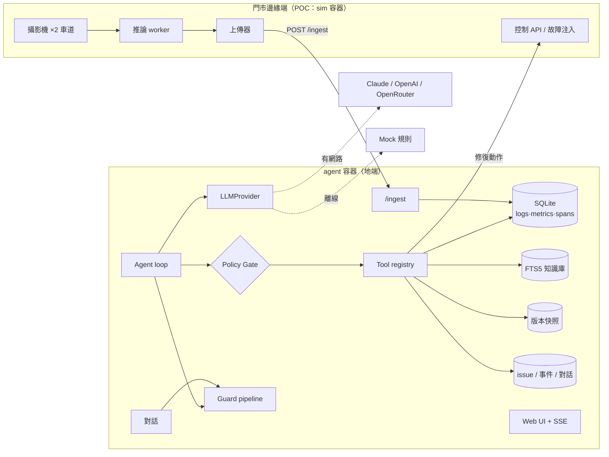
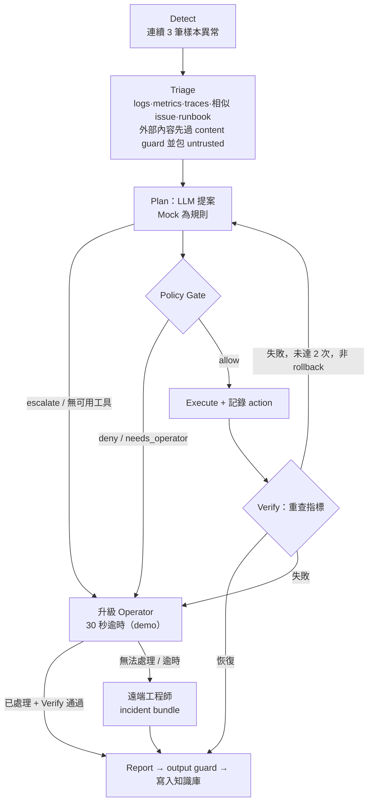

# 架構設計

> 範圍：POC（MVP）。標示「POC 專用」的元件不屬於正式執行路徑；每個外部依賴都在 Port 後面，正式版替換 adapter 即可。

## 1. 系統總覽



## 2. 目錄與依賴規則（Hexagonal + 模組化單體）

```
agent/src/aicam/
  core/       loop、policy、executor、versions、guards（管線）、chat、untrusted、constants  ← 純邏輯
  ports/      介面（Protocol）：llm obs kb issues versions notifier edge guard mcp
  adapters/   sqlite/  llm/（mock、cloud、auto、factory）  edge/  guards/（builtin、factory）
  plugins/    registry（ToolSpec manifest）、loader、skills、builtin/*（內建工具）
  prompts/    分層 system prompt
  api/        FastAPI app factory、routes、schemas（pydantic）
  poc/        seed 資料（POC 專用）
  config.py   TOML + 環境變數
  runtime.py  Runtime：所有 port 實例 + 可熱重載的 tools / skills / guards
```

依賴方向：`api → core → ports ← adapters`；`plugins` 依賴 `core.executor` 的 `Call` 與 `ports`；`core` 不 import `adapters`。
（已知例外：`core/loop.py` 經由 `Runtime` 使用具體 adapter 的方法，介面由 `ports/` 描述，POC 不做執行期型別強制。）

## 3. Ports 與可抽換實作

| Port | POC 實作 | 正式版候選 |
|---|---|---|
| LLMProvider | Mock、OpenAI-compatible（OpenAI／OpenRouter）、Anthropic、AutoLLM（失敗退回 Mock，30 秒冷卻） | vLLM / Ollama |
| ObservabilityPort | SQLite | Loki / Prometheus / Tempo |
| KnowledgePort | SQLite FTS5（trigram） | 向量庫 + bge-m3 |
| IssueStore / VersionStore | SQLite | Postgres / Git・設定中心 |
| Notifier | outbox 表 | PagerDuty / LINE / Slack |
| EdgeControlPort | sim 控制 API | 真實邊緣控制通道 |
| GuardPort | 規則式 guard（可離線） | 加 LLM 判官、DLP 服務 |
| McpSourcePort | 只有介面 | MCP client adapter |

## 4. Agent loop



issue 狀態：`detected → triaging → acting → verifying → resolved`；失敗路徑 `waiting_operator → escalated_engineer → resolved`。
每條車道同時最多一個 open issue；結案後只看結案之後的新樣本，避免舊資料再次觸發。
**重啟 recover**：handler 是記憶體中的 task，重啟後會消失，所以啟動時 `Agent.recover()` 會把仍在等待 Operator／工程師的 issue 重新接上它的待處理升級單，其他處理到一半的 issue 標記「重啟中斷」並結案（讓偵測器重新偵測）。

偵測規則（`core/loop.py: classify`，優先序由上而下）：`stream_connected` 全為 0 → `camera_no_signal`；`fps` 全為 0 → `inference_stalled`；`detections_per_min` 全低於門檻 → `detection_drop`。

## 5. Policy Gate（`core/policy.py`，純程式碼）

風險等級由 tool manifest 宣告；沒有合法等級的工具無法註冊（default-deny）。

| 等級 | 處置 |
|---|---|
| L0 唯讀 | 自動 |
| L1 可逆低風險 | 自動；同工具同車道 2 次／10 分鐘上限；必須 Verify |
| L2 影響營運 | 需 Operator 核准 |
| L3 不可逆／未知 | 只產 incident bundle，呼叫遠端工程師 |

動態規則：
- `rollback_version`：回復 Agent 本次事件自己的變更 → L1；他人變更、且**程式碼算出的**相關性證據（loop 的 `find_suspect` → `Call.evidence`，由 executor 驗證對應目前 head 與目標版本，LLM 無法自填）成立、且目標為上一版 → L1；使用者／UI 要求、或更早版本 → 需 Operator 確認。Rollback 後 Verify 失敗不重複 rollback。
- `apply_config`：Operator／工程師的變更只記錄來源；Agent 只能改白名單路徑（`policy.agent_writable`），其他需 Operator 確認。
- 所有工具呼叫唯一入口是 `core/executor.execute`：registry（啟用?）→ 來源旗標（LLM 規劃的動作須 `plannable`，對話須 `chat`；程式自身的 triage 用 `system` 來源）→ 參數驗證（inputSchema）→ Policy → 執行（有 timeout）→ 紀錄。

## 6. 版本快照

`versions(seq, parent_seq, content_json, sha256, actor, reason, issue_id, ts)`，append-only：
- 所有設定變更經 `apply_config`，變更前後自動快照；內容雜湊相同不新增版本。
- rollback = 新增一版（內容等於目標版），所以 rollback 本身也能再 rollback；歷史不刪。
- 只存 `${SECRET:name}` 引用，含明文憑證（`://user:pass@`）的內容拒收。
- 限制：整份設定為粒度，rollback 會連同上一版之後的無關變更一併還原（正式版可分區版本）。

## 7. 外掛與設定（細節見 `docs/config-reference.md`）

- **Tools**：`ToolSpec` manifest（名稱、MCP 相容 schema、等級、是否可由 Agent 規劃／對話呼叫）。`[tools]` 逐一開關；python 外掛與 MCP 來源預設停用。MCP 只有介面（`McpSourcePort`），沒有內建 adapter。
- **Skills**：`config/skills/*/SKILL.md`，需要的工具被停用時自動失效。
- **RAG**：`[knowledge] sources` 選擇 FTS5 的 kind（runbook／issue）。
- **熱重載**：`POST /api/admin/reload`；設定有誤（未知工具、未知 guard、未安裝的 MCP adapter）維持原狀態並回 400。

## 8. Prompt 與安全

- **分層 prompt**：檔案層（`config/prompts/*.md`）＋ UI 層（DB，可即時新增／停用，有歷史與回復）＋ 啟用的 skills ＋ 固定安全規則（不可編輯，含 canary）。scope：agent／chat／all。
- **Guard pipeline**（`[guards.*]`，可插拔）：
  - input：`length`、`injection`、`role_scope`（Operator 越權意圖：刪資料、關 policy、要金鑰、改 prompt／設定、ssh）
  - output：`secret_redact`、`prompt_leak`（canary + 逐行比對）、`unsafe_command`
  - content（log 等外部內容）：`content_injection` → 標記並包 `<untrusted>`
- **功能開關取代 RBAC**：POC 使用者固定為 Operator；聊天、改 prompt、重載設定、工具啟停、LLM 連線測試、demo 控制由 `[features]` 控制，關閉時 API 回 403、UI 隱藏。
- **分層防線**：prompt 讓真實 LLM 拒絕；guard、Policy Gate、功能開關由程式碼強制，不依賴 LLM 聽話。Mock 不解讀 prompt，UI 與連線測試會如實標示 `MOCK`。

## 8.1 LLM 容錯（雲端模型的輸出不可靠）
- **prompt 帶完整工具 schema**（參數、型別、必填），不只給名稱，避免模型猜參數。
- **參數校正在 executor 統一處理**（`plugins/registry.normalize_args`）：別名（`lane_id→lane`、`duration→since_hours`）、轉型（`"1"→1`、`"2d"→48` 小時）；唯讀工具丟棄未知參數，動作類工具仍拒絕。校正不放寬權限，Policy Gate 照常判定，並在時間軸記錄「參數已校正」。
- **回應解析容忍常見變體**：`arguments`／`parameters`、單一物件、`{"calls":[…]}`、code fence、JSON 字串參數；答案若是工具呼叫 JSON，改用工具結果摘要。
- **JSON 擷取不貪婪**：逐個 `[`／`{` 位置 `raw_decode`，取第一個「符合預期」的值，所以前後的說明文字、`[1]`、`[搜尋歷史]` 之類的括號都不會讓解析失敗。
- **JSON 任務的可靠度**：`temperature=0`、`response_format=json_object`（供應商回 400/404/422 就自動降級並記住）；prompt 加入 few-shot（只含已啟用工具）與「不需要工具回 `{"calls":[]}`」；第一次無法解析時，附上原因與原回覆片段**自動重問一次**，仍失敗才退回 Mock。
- **退回 Mock 時仍要答對**：Mock 的意圖規則容忍錯字（「聊果」「剛剛問了什麼」）；`search_history` 沒有關鍵字或搜不到時，改列出最近的對話。
- **對話最多一次「附錯誤訊息的重新規劃」**，不會無限重試。
- **退回策略分兩類**：格式錯誤只讓「這一次」改用 Mock；連線錯誤才鎖雲端 30 秒。`info()` 回報 `last_error`，UI 徽章顯示退回原因。
- **Reset 依 `.env` 重建 provider**，立即解除退回狀態（`Runtime.reset_llm`）。

## 9. 資料表

`logs`、`metrics`、`spans`、`issues`、`events`（時間軸，type：detect／triage／plan／policy／tool／verify／escalate／operator／engineer／report／version／guard／config／prompt／llm／error）、`actions`、`escalations`、`messages`、`versions`、`outbox`、`prompt_layers`、`prompt_history`、`kb`（FTS5）。

## 10. 已知限制

- Detect／Verify 以 Agent 主機時間比對 edge 傳來的 `ts`（POC 同機；真實部署需以接收時間為準）。
- 同步 SQLite 在 async handler 內執行（毫秒級小查詢，POC 接受）。
- 無身分驗證：任何能連到 8000 埠的人都等同 Operator；正式版需 SSO／JWT 與 RBAC。
- Guard 為規則式，可被刻意繞過；不是完整防護。正式版加 LLM 判官與 DLP。
- 修復動作作用於模擬器；`physical_fix` 模擬現場人員處理，不是真實動作。
- Docker Compose 與真實雲端 LLM 未在開發環境（無 Docker／無金鑰）驗證，見 `todo.md`。
